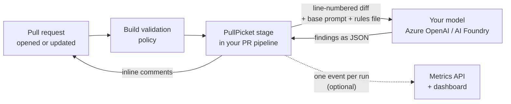

<p align="center">
  
</p>

<h1 align="center">PullPicket</h1>

<p align="center">
  <b>AI pull request review for Azure DevOps, on models you host in Azure.</b>
</p>

<p align="center">
  <a href="https://github.com/Antarsoft/pullpicket/actions/workflows/ci.yml"></a>
  <a href="https://github.com/Antarsoft/pullpicket/releases/latest"></a>
  <a href="LICENSE"></a>
  
  
  
</p>

<p align="center">
  <a href="#quick-start-about-15-minutes">Quick start</a> ·
  <a href="#set-up-with-an-ai-agent">Set up with an AI agent</a> ·
  <a href="docs/parameters.md">Parameters</a> ·
  <a href="docs/metrics.md">Metrics</a> ·
  <a href="docs/troubleshooting.md">Troubleshooting</a> ·
  <a href="CHANGELOG.md">Changelog</a>
</p>

PullPicket is a pipeline stage template that sends the changes in a pull request to a model you host in Azure OpenAI or Azure AI Foundry, then posts the findings back to the pull request as inline comments. An optional metrics service records each run so you can see cost, volume and outcomes on a dashboard.

| | |
| --- | --- |
| **Fits your pipeline** | One `template:` line in the PR pipeline you already have. No extension to install, no server to run. |
| **No API keys** | Signs in to the model and to Azure DevOps with the service connection's Entra identity. |
| **Your rules** | A short rules file in each repository says what matters there; a shared base prompt handles the rest. |
| **Your data stays in Azure** | The diff goes only to your own model deployment. |

## Contents

- [What it does](#what-it-does)
- [How it works](#how-it-works)
- [Quick start (about 15 minutes)](#quick-start-about-15-minutes)
- [Set up with an AI agent](#set-up-with-an-ai-agent)
- [Rules files](#rules-files)
- [Configuration](#configuration)
- [Cost notes](#cost-notes)
- [Metrics dashboard (optional)](#metrics-dashboard-optional)
- [Documentation](#documentation)
- [Repository layout](#repository-layout)
- [Development and CI](#development-and-ci)
- [Security](#security)
- [Licence](#licence)

## What it does

- Reviews every pull request that runs your PR pipeline and posts comments on the changed lines, each tagged `CRITICAL`, `WARNING` or `SUGGESTION`.
- Uses a shared base prompt plus a short rules file that you keep in your own repository, so each repository describes its own stack and conventions.
- Splits large pull requests into batches, skips lockfiles, generated output and binaries, and stays within per-file and per-batch token limits.
- Remembers its own earlier comments on the pull request, so a new push does not repeat a finding that is already open.
- Treats the diff as untrusted data: text in the code that tries to steer the reviewer is flagged instead of followed.
- Signs in to the model and to Azure DevOps with the identity of an Azure Resource Manager service connection (Entra ID). No API keys are needed by default.
- Optionally sends one event per run (tokens, comments, outcome, latency) to a small metrics API with a dashboard.

PullPicket only reviews pull requests in Azure Repos, using models hosted in Azure. GitHub and GitLab as review hosts and non-Azure model providers are out of scope for 1.0.

<p align="center">
  
</p>

<sub>Illustration with a placeholder repository and code. Comments appear as ordinary pull request threads on the changed lines.</sub>

## How it works



For each run, the stage:

1. checks out your repository (full history) and this repository as `templates`,
2. reads the bot's existing comment threads on the pull request,
3. builds a line-numbered diff of target...source, minus excluded files,
4. sends it in batches to your model with the base prompt and your rules file,
5. validates each finding against the diff and posts it as a pull request thread,
6. prints a run summary and, if configured, sends a metrics event.

The engine is a PowerShell 7 module (`ai-code-review/AICodeReview.psd1`) that runs inside an `AzurePowerShell@5` task. The model is called through the chat completions API with a strict JSON schema, so every finding comes back as `fileName`, `lineNumber`, `severity` and `comment`. Findings that point at a line outside the diff are moved to the nearest changed line or dropped.

If some batches fail, the comments from the batches that worked are still posted and the step is marked as failed afterwards, so a partial review is never silent.

## Quick start (about 15 minutes)

You need an Azure DevOps project with an Azure Repos repository, an Azure subscription, and permission to create service connections and branch policies.

### 1. Import this repository

Import PullPicket into your Azure DevOps organisation (Repos > Import repository) or keep it on GitHub and reach it through a GitHub service connection. Pin a release tag, such as `v1.0.0`, so template changes only reach your pipelines when you choose.

A new project already has a repository named after the project. Import into a new repository named `pullpicket`, or, if you import into that default one, use its name in step 6 (`name: <project>/<project>`).

### 2. Deploy a model

Create an Azure OpenAI or Azure AI Foundry resource and deploy a chat model. Any chat model that supports structured output (`response_format` with a JSON schema) works; PullPicket does not prescribe one. Note the deployment's chat completions URL (it ends in `/chat/completions?api-version=...`). For a classic Azure OpenAI resource (`https://<resource>.openai.azure.com/`), also set `foundryTokenResource: 'https://cognitiveservices.azure.com'` in step 6; the default suits Azure AI Foundry.

### 3. Create a service connection and grant it access

Create an **Azure Resource Manager** service connection (workload identity federation is recommended). Its identity needs:

- the **Cognitive Services OpenAI User** role on the model resource, and
- membership in your Azure DevOps organisation, with permission to **Contribute to pull requests** on the repositories it reviews.

To add a service principal as an organisation user, the organisation must be connected to the identity's Microsoft Entra tenant (Organization settings > Microsoft Entra). Otherwise Azure DevOps treats the name as an email address and rejects it.

The review needs no Azure management role. When Azure DevOps creates the connection automatically it grants **Contributor** on the subscription or resource group you pick; you can remove that assignment.

### 4. Create the variable group

Create a variable group (default name `ai-code-review`) under Pipelines > Library:

| Variable | Example | Notes |
| --- | --- | --- |
| `modelName` | `<your-deployment-name>` | Your model deployment's name, sent as `model` in each request and recorded in metrics. |
| `modelDeploymentUrl` | `https://<resource>.openai.azure.com/openai/deployments/<deployment>/chat/completions?api-version=<version>` | Full chat completions URL. |
| `reasoningEffort` | `medium` | Optional. Leave empty for models that do not support it. |

### 5. Add a rules file to your repository

Copy the closest example from [`examples/rules/`](examples/rules) into your repository, for example to `pipelines/ai-code-review/my-repo.rules.md`, and edit it to match your stack. See [Rules files](#rules-files).

### 6. Add the stage to your PR pipeline

```yaml
trigger: none

resources:
  repositories:
    - repository: templates                # the alias must be exactly "templates"
      type: git
      name: <project>/pullpicket
      ref: refs/tags/v1.0.0

stages:
  - template: ai-code-review/stage-template.yml@templates
    parameters:
      azureSubscription: 'my-ai-review-connection'
      promptFile: 'pipelines/ai-code-review/my-repo.rules.md'
      promptMode: rules
      foundryAuth: entra
```

A fuller example with a build stage is in [`examples/pipelines/pr-pipeline.yml`](examples/pipelines/pr-pipeline.yml).

> **The repository alias must be `templates`.** The stage checks out the PullPicket repository by that name and loads the engine from `$(Pipeline.Workspace)/templates/`. Any other alias fails the checkout.

The first time the pipeline runs, approve its access to the service connection, the variable group and the `templates` repository when Azure DevOps asks.

### 7. Turn it on for pull requests

Add the pipeline as a **build validation** policy on your target branch (Repos > Branches > Branch policies). Azure Repos ignores the YAML `pr:` trigger; the branch policy is what queues PR runs. Open a pull request and the review comments appear when the stage finishes.

> **Upgrading from a pre-1.0 copy?** `foundryAuth` now defaults to `entra`, `promptMode` defaults to `rules`, and the `AutoApprove` option is removed. If you used key auth or a full legacy prompt, set `foundryAuth: key` or `promptMode: legacy` explicitly. See [CHANGELOG.md](CHANGELOG.md).

## Set up with an AI agent

If you use an AI coding agent that can run shell commands, such as Claude Code, you can hand it the setup. Open the agent in a clone of the repository that should get reviews, paste the prompt below, and answer its questions. The agent works through the steps in order, runs the `az` and `git` commands itself, checks each step before it moves on, and stops to ask you whenever a step needs a person in the Azure DevOps or Azure portal.

You still need the same access as the [quick start](#quick-start-about-15-minutes), and the agent acts with whatever `az` sign-in you give it. Read each command before you approve it.

<details>
<summary><b>Copy the setup prompt</b></summary>

````markdown
You are setting up PullPicket (https://github.com/Antarsoft/pullpicket), an AI pull request
reviewer for Azure DevOps, for my repository. Work through the steps below in order. Treat the
PullPicket README, infra/README.md, docs/metrics.md and docs/troubleshooting.md at tag v1.0.0 as
the source of truth; read them before you start and follow them where they differ from this prompt.

Ground rules:
- Ask me for every value in "Inputs" before you run anything. Do not guess names or IDs.
- Run commands one at a time. Show me each command before you run it. Never put a `# comment`
  on the same line as a command (zsh echoes it when pasted).
- Use the Azure CLI (2.60 or later) and the azure-devops extension (`az extension add --name azure-devops`).
  Where the CLI cannot do a step, give me the exact portal path and wait until I say it is done.
- After each step, check the result (a command, or ask me) before you continue. If a check
  fails, look in docs/troubleshooting.md first, then stop and tell me.
- Never print secrets. Do not commit `.env.entra` or any key. Delete `.env.entra` at the end.
- Keep a checklist of the steps and show it to me as you go.

Inputs (ask me for all of these first):
1. Azure DevOps organisation URL and project name.
2. The repository to review, its default branch, and its stack (for the rules file).
3. Azure subscription ID, a resource group name and a region.
4. Whether I already have an Azure OpenAI or Azure AI Foundry model deployment. If yes: its
   chat completions URL and deployment name, and whether it is a classic Azure OpenAI resource
   (https://<name>.openai.azure.com/). If no: which model to deploy.
5. The service connection name to create, or an existing Azure Resource Manager one to reuse.
6. Whether I want the optional metrics dashboard (Part 2).

Part 1: the review stage

1. Prerequisites. `az login`, `az account set --subscription <id>`, and
   `az devops configure --defaults organization=<org url> project=<project>`. Register the
   providers the model needs on a new subscription:
   `az provider register --namespace Microsoft.CognitiveServices`.
2. Import PullPicket into the Azure DevOps project as a NEW repository named `pullpicket`
   (`az repos create`, then `az repos import create --git-source-url https://github.com/Antarsoft/pullpicket.git`).
   A new project already has a repository named after the project; do not import into it, or the
   pipeline's `name:` must become `<project>/<project>`. Pin the pipeline to `refs/tags/v1.0.0`.
3. Model. If I have none, create an Azure OpenAI or AI Foundry resource in the resource group and
   deploy a chat model that supports structured output (`response_format` with a JSON schema).
   Note the full chat completions URL (it ends in `/chat/completions?api-version=...`) and the
   deployment name.
4. Service connection. Create an Azure Resource Manager service connection with workload identity
   federation, or reuse mine. Find its application (client) ID. Then:
   - Grant its identity **Cognitive Services OpenAI User** on the model resource (`az role assignment create`).
   - The review needs no Azure management role. If Azure DevOps created the connection and gave it
     **Contributor** on the subscription or resource group, tell me and offer to remove it.
5. Azure DevOps access for the identity. This is the most common miss, and the stage can still go
   green without posting anything if it is wrong.
   - The organisation must be connected to the identity's Entra tenant (Organization settings >
     Microsoft Entra). Otherwise adding the service principal fails with "Given email address ... is invalid".
   - Add the identity to the organisation with Basic access (Organization settings > Users), and give it
     **Contribute to pull requests** on the repository (Project settings > Repositories > <repo> > Security).
   Ask me to do these in the portal and wait for me to confirm.
6. Variable group `ai-code-review` (`az pipelines variable-group create`) with `modelName` (the deployment
   name), `modelDeploymentUrl` (the full chat completions URL) and optionally `reasoningEffort`.
7. Rules file. Copy the closest file from PullPicket's `examples/rules/` to
   `pipelines/ai-code-review/<repo>.rules.md` in my repository and adapt it to my stack: one sentence on
   the stack, numbered rules with severities, and a "conventions to respect" section for what tooling
   already enforces. Keep it short. Show it to me before you commit.
8. Pipeline. Add the stage to my PR pipeline, based on PullPicket's `examples/pipelines/pr-pipeline.yml`.
   The repository resource alias must be exactly `templates`. Set `azureSubscription`, `promptFile`,
   `promptMode: rules` and `foundryAuth: entra`. For a classic Azure OpenAI resource also set
   `foundryTokenResource: 'https://cognitiveservices.azure.com'`. Commit on a new branch and open a
   pull request in my repository; do not push to the default branch.
9. Create the pipeline (`az pipelines create`) and add it as a **build validation** policy on the default
   branch (`az repos policy build create`). Azure Repos ignores the YAML `pr:` trigger.
10. First run. On the first run, Azure DevOps asks for permission to use the service connection, the
    variable group and the `templates` repository. Ask me to approve them.

Part 2: the metrics dashboard (only if I said yes)

Follow infra/README.md "Deploy", steps 1 to 7, from a clone of PullPicket at v1.0.0.
11. Register the providers: Microsoft.App, Microsoft.OperationalInsights, Microsoft.DocumentDB,
    Microsoft.ContainerRegistry and Microsoft.ManagedIdentity. Check I have Owner (or Contributor plus
    Role Based Access Control Administrator) on the resource group, and rights to create app registrations.
12. First deployment with no image tag: `az deployment group create --resource-group <rg> --parameters infra/main.bicepparam --query properties.outputs --output json`.
    Note `registryName` and `metricsUrl`.
13. `infra/setup-entra.sh --app-url <metricsUrl>`. It writes `.env.entra`. If the tenant only allows
    application ID URIs on a verified domain, the script falls back to `api://<API client id>` instead of
    `api://pullpicket-metrics`; use whatever `PULLPICKET_API_APP_ID_URI` in `.env.entra` says from here on.
14. Build the image: `export PULLPICKET_IMAGE_TAG="$(git rev-parse --short HEAD)"`, then
    `az acr build --registry <registryName> --image "pullpicket-metrics:$PULLPICKET_IMAGE_TAG" metrics`.
15. `source .env.entra`, then run the same deployment again to create the Container App.
16. `infra/grant-events-write.sh --principal <service connection client id>`.
17. Variable group `ai-code-review-metrics` with `aiMetricsApiUrl` = `metricsUrl` and
    `aiMetricsApiResource` = `PULLPICKET_API_APP_ID_URI`. Add `metricsVariableGroup: 'ai-code-review-metrics'`
    to the stage parameters in my pull request. Leave `metricsAuth` at its default, `entra`.
18. Check: `POST <metricsUrl>/events` with no credential returns 401, `GET <metricsUrl>/healthz` returns 200,
    and `GET <metricsUrl>/metrics/summary?feature=ai-code-review` does not return 200 without sign-in.
19. Delete `.env.entra`.

Verify (both parts)
- Ask me to push a small change to the open pull request that a reviewer would flag.
- The PullPicket stage ran. Do not trust a green stage alone: check the log has no
  `WARNING: Failed to post comment` and no `Failed to acquire access token`, and ask me to confirm the
  comments are on the right files and lines.
- A second push does not repeat comments that are already open.
- If Part 2 is set up: the stage log shows the metrics event was sent without 401 or 403, and the run is on
  `<metricsUrl>/dashboard?feature=ai-code-review` after I sign in. The engine version shows `v1.0.0`.

When you finish, give me a short summary: what you created (with names), what I did by hand, any role you
suggested removing, and how to tear it all down (`az group delete`, and `az ad app delete` for the two
pullpicket-metrics app registrations).
````

</details>

The prompt follows the same steps as the quick start and [infra/README.md](infra/README.md), plus the snags found while testing 1.0.0 on a fresh subscription and project. If the agent gets stuck, [Troubleshooting](docs/troubleshooting.md) has the fixes it should try first.

## Rules files

A rules file tells the reviewer what matters in one repository. In `rules` mode the engine sends the shared base prompt ([`ai-code-review/prompts/base.codereviewprompt.md`](ai-code-review/prompts/base.codereviewprompt.md)) followed by your rules file. The base prompt owns the input and output format, severity levels and the untrusted-content policy. Your rules file owns what counts as a finding, and wins where the two disagree on that.

A good rules file is short and specific:

- one sentence on the stack and what the repository is,
- numbered rules grouped by topic, each with the severity it deserves,
- a "conventions to respect" section listing what tooling already enforces (formatting, import order) so the reviewer leaves it alone.

Examples: [Next.js](examples/rules/nextjs.rules.md), [NestJS](examples/rules/nestjs.rules.md), [Terraform](examples/rules/terraform.rules.md).

The rules file is excluded from its own review. In `legacy` mode the file you pass is the complete prompt and the base prompt is not used.

## Configuration

The stage takes its settings as template parameters. The ones you are most likely to change:

| Parameter | Default | Purpose |
| --- | --- | --- |
| `azureSubscription` | (required) | Service connection the review runs as. |
| `promptFile` | (required) | Path to your rules file, relative to the repository root. |
| `promptMode` | `rules` | `rules` adds the shared base prompt; `legacy` uses your file as the whole prompt. |
| `foundryAuth` | `entra` | `entra` signs in with the service connection; `key` reads `foundry-key` from the variable group. |
| `modelVariableGroup` | `ai-code-review` | Variable group with the model settings. |
| `metricsVariableGroup` | empty | Variable group for the metrics API. Empty sends no metrics. |
| `metricsAuth` | `entra` | `entra` sends a token for `aiMetricsApiResource` from the service connection; `key` sends `aiMetricsApiKey` as `X-Api-Key`. |
| `reviewPathSpec` / `reviewExcludePathSpec` | empty | Limit the review to, or exclude, paths. |
| `reviewDefaultExcludes` | `true` | Skip lockfiles, minified files, images, fonts, archives and binaries. |

Every parameter, with its type, default and allowed values, is in the [parameter reference](docs/parameters.md). It is generated from the comments in [`ai-code-review/stage-template.yml`](ai-code-review/stage-template.yml), and CI fails if the two drift apart.

If the stage is skipped, posts nothing, or the model call fails, see [Troubleshooting](docs/troubleshooting.md).

## Cost notes

You pay your Azure model provider per token; PullPicket adds no charge. What drives the bill:

- **Diff size.** Each run sends the line-numbered diff of the pull request plus the base prompt and rules file. Bigger pull requests cost more.
- **Batches.** A large pull request is split into batches (`reviewMaxFilesPerBatch`, `reviewMaxBatchTokens`), and each batch repeats the prompt. Very large single files are truncated at `reviewMaxFileTokens`.
- **Re-runs.** Every push to the pull request runs a new full review of the whole diff.
- **Reasoning.** Reasoning models also bill reasoning tokens; `reasoningEffort` controls how many.

Ways to keep costs down: leave `reviewDefaultExcludes` on, use `reviewPathSpec` or `reviewExcludePathSpec` to skip generated or vendored code, pick a smaller model for routine repositories, and use the metrics dashboard to see tokens and estimated cost per run.

## Metrics dashboard (optional)

`metrics/` is a small Go service that stores one event per review run in Cosmos DB and serves a dashboard with runs, comments, severities, errors, tokens, latency and estimated cost over time. [`infra/`](infra/README.md) deploys it to Azure in one resource group: Cosmos DB with key auth disabled, Container Apps running as a managed identity, and Entra sign-in in front of the dashboard.

To connect a pipeline, create a variable group with `aiMetricsApiUrl` and `aiMetricsApiResource` (the API's application ID URI) and pass its name as `metricsVariableGroup`. `POST /events` always needs a credential: an Entra token carrying the API's `Events.Write` role (`metricsAuth: entra`, the default) or a shared key (`metricsAuth: key`). Without the variable group, the stage skips the metrics event.

[docs/metrics.md](docs/metrics.md) covers deploying, both auth modes, reading the dashboard, the pricing file for cost estimates, every environment variable, and running the service locally.

## Documentation

| Guide | What is in it |
| --- | --- |
| [Parameter reference](docs/parameters.md) | Every stage parameter with its type, default and allowed values. |
| [Troubleshooting](docs/troubleshooting.md) | Skipped stages, missing comments, 401/403/404 from the model, agent pool overrides. |
| [Metrics guide](docs/metrics.md) | Deploying the metrics API, both auth modes, the dashboard, pricing and local runs. |
| [Metrics infrastructure](infra/README.md) | Bicep deployment, Entra app registrations and teardown. |
| [Security](SECURITY.md) | What the model and the metrics service receive, hardening, and private reporting. |
| [Contributing](CONTRIBUTING.md) | Local setup, checks, commit style and DCO sign-off. |
| [Changelog](CHANGELOG.md) | What changed in each release, including the 1.0.0 breaking defaults. |

## Repository layout

| Path | What it is |
| --- | --- |
| `ai-code-review/` | The review engine: PowerShell module, stage template, base prompt and Pester tests. |
| `examples/` | An example PR pipeline and example rules files. |
| `metrics/` | Optional metrics ingestion API and dashboard (Go, Cosmos DB). |
| `infra/` | Bicep and Entra setup scripts for the metrics infrastructure. |
| `docs/` | Parameter reference, troubleshooting and the metrics guide. |
| `tools/` | Maintenance scripts, such as the parameter reference generator. |
| `.github/` | GitHub Actions CI and Dependabot configuration. |
| `.azuredevops/` | Azure Pipelines CI for the engine, for teams that host a copy in Azure Repos. |

## Development and CI

Every push to `main` and `development` and every pull request runs [GitHub Actions CI](.github/workflows/ci.yml):

| Job | What it checks |
| --- | --- |
| PowerShell | Pester 5.6.1 tests in `ai-code-review/tests`, PSScriptAnalyzer 1.23.0 with zero findings allowed, and a check that [`docs/parameters.md`](docs/parameters.md) matches the template. |
| Go | `gofmt`, `go vet`, `go test -race` and `go build` for `metrics/`. |
| Docker | Builds the metrics image (no push), checks it does not run as root, smoke-tests `/healthz`, and checks an unauthenticated `POST /events` gets `401`. |
| Secret scan | gitleaks over the full git history. |
| DCO sign-off | On pull requests, every commit carries a `Signed-off-by` line (see [CONTRIBUTING.md](CONTRIBUTING.md#developer-certificate-of-origin)). |
| Bicep | Builds and lints every file under `infra/` with a pinned Bicep CLI, and runs shellcheck on its scripts. |

Actions are pinned by commit SHA, the workflow token is read-only, and Dependabot keeps actions, Go modules and the Docker base image current.

Run the same checks locally before you push:

```powershell
# PowerShell 7
Invoke-Pester -Path ai-code-review/tests
Invoke-ScriptAnalyzer -Path ai-code-review -Settings ai-code-review/PSScriptAnalyzerSettings.psd1
```

```bash
cd metrics
gofmt -l . && go vet ./... && go test -race ./... && go build ./...
```

To contribute, see [CONTRIBUTING.md](CONTRIBUTING.md) for local setup, the checks, commit style and the DCO sign-off.

## Security

The model receives your base prompt and rules file, file paths and line numbers, the line-numbered diff with a few lines of context, the branch names, and the first 150 characters of the bot's own earlier comments on the pull request. Content in the diff is treated as untrusted and is never followed as an instruction, and the reviewer can only comment: it cannot approve, vote or change code.

[SECURITY.md](SECURITY.md) lists exactly what the model and the metrics service receive, how prompt injection and credentials are handled, a hardening checklist, and how to report a vulnerability privately.

## Licence

PullPicket is licensed under the [Apache License 2.0](LICENSE).
