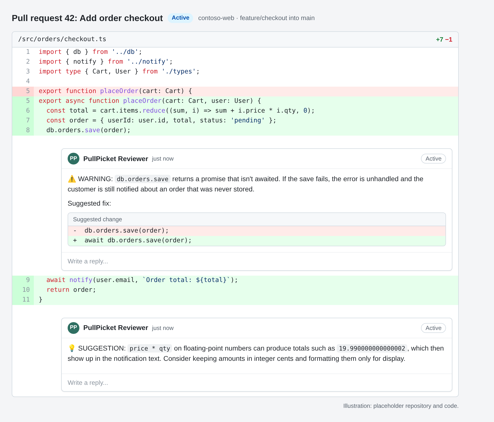

<p align="center">
  
</p>

<h1 align="center">PullPicket</h1>

AI pull request review for Azure DevOps. PullPicket is a pipeline stage template that sends the changes in a pull request to a model you host in Azure OpenAI or Azure AI Foundry, then posts the findings back to the pull request as inline comments. An optional metrics service records each run so you can see cost, volume and outcomes on a dashboard.

> **Status: pre-1.0.** The defaults described here are the planned 1.0.0 behaviour. Until 1.0.0 is tagged, set `foundryAuth` and `promptMode` explicitly as the quick start does, and see [CHANGELOG.md](CHANGELOG.md) for what has landed.

## Contents

- [What it does](#what-it-does)
- [How it works](#how-it-works)
- [Quick start (about 15 minutes)](#quick-start-about-15-minutes)
- [Rules files](#rules-files)
- [Configuration](#configuration)
- [Cost notes](#cost-notes)
- [Metrics dashboard (optional)](#metrics-dashboard-optional)
- [Repository layout](#repository-layout)
- [Development and CI](#development-and-ci)
- [Security](#security)
- [Licence](#licence)

## What it does

- Reviews every pull request that runs your PR pipeline and posts comments on the changed lines, each tagged `CRITICAL`, `WARNING` or `SUGGESTION`.
- Uses a shared base prompt plus a short rules file that you keep in your own repository, so each repository describes its own stack and conventions.
- Splits large pull requests into batches, skips lockfiles, generated output and binaries, and stays within per-file and per-batch token limits.
- Remembers its own earlier comments on the pull request, so a new push does not repeat a finding that is already open.
- Treats the diff as untrusted data: text in the code that tries to steer the reviewer is flagged instead of followed.
- Signs in to the model and to Azure DevOps with the identity of an Azure Resource Manager service connection (Entra ID). No API keys are needed by default.
- Optionally sends one event per run (tokens, comments, outcome, latency) to a small metrics API with a dashboard.

PullPicket only reviews pull requests in Azure Repos, using models hosted in Azure. GitHub and GitLab as review hosts and non-Azure model providers are out of scope for 1.0.

<p align="center">
  
</p>

<sub>Illustration with a placeholder repository and code. Comments appear as ordinary pull request threads on the changed lines.</sub>

## How it works

```
PR opened or updated
  └─ build validation policy queues your PR pipeline
       └─ PullPicket stage (ai-code-review/stage-template.yml)
            1. checks out your repo (full history) and this repo as `templates`
            2. reads the bot's existing comment threads on the PR
            3. builds a line-numbered diff of target...source, minus excluded files
            4. sends it in batches to your model with the base prompt + your rules file
            5. validates each finding against the diff and posts it as a PR thread
            6. prints a run summary and, if configured, sends a metrics event
```

The engine is a PowerShell 7 module (`ai-code-review/AICodeReview.psd1`) that runs inside an `AzurePowerShell@5` task. The model is called through the chat completions API with a strict JSON schema, so every finding comes back as `fileName`, `lineNumber`, `severity` and `comment`. Findings that point at a line outside the diff are moved to the nearest changed line or dropped.

If some batches fail, the comments from the batches that worked are still posted and the step is marked as failed afterwards, so a partial review is never silent.

## Quick start (about 15 minutes)

You need an Azure DevOps project with an Azure Repos repository, an Azure subscription, and permission to create service connections and branch policies.

### 1. Import this repository

Import PullPicket into your Azure DevOps organisation (Repos > Import repository) or keep it on GitHub and reach it through a GitHub service connection. Pin a release tag, such as `v1.0.0`, so template changes only reach your pipelines when you choose.

### 2. Deploy a model

Create an Azure OpenAI or Azure AI Foundry resource and deploy a chat model. Any chat model that supports structured output (`response_format` with a JSON schema) works; PullPicket does not prescribe one. Note the deployment's chat completions URL (it ends in `/chat/completions?api-version=...`).

### 3. Create a service connection and grant it access

Create an **Azure Resource Manager** service connection (workload identity federation is recommended). Its identity needs:

- the **Cognitive Services OpenAI User** role on the model resource, and
- membership in your Azure DevOps organisation, with permission to **Contribute to pull requests** on the repositories it reviews.

### 4. Create the variable group

Create a variable group (default name `ai-code-review`) under Pipelines > Library:

| Variable | Example | Notes |
| --- | --- | --- |
| `modelName` | `<your-deployment-name>` | Your model deployment's name, sent as `model` in each request and recorded in metrics. |
| `modelDeploymentUrl` | `https://<resource>.openai.azure.com/openai/deployments/<deployment>/chat/completions?api-version=<version>` | Full chat completions URL. |
| `reasoningEffort` | `medium` | Optional. Leave empty for models that do not support it. |

### 5. Add a rules file to your repository

Copy the closest example from [`examples/rules/`](examples/rules) into your repository, for example to `pipelines/ai-code-review/my-repo.rules.md`, and edit it to match your stack. See [Rules files](#rules-files).

### 6. Add the stage to your PR pipeline

```yaml
trigger: none

resources:
  repositories:
    - repository: templates                # the alias must be exactly "templates"
      type: git
      name: <project>/pullpicket
      ref: refs/tags/v1.0.0

stages:
  - template: ai-code-review/stage-template.yml@templates
    parameters:
      azureSubscription: 'my-ai-review-connection'
      promptFile: 'pipelines/ai-code-review/my-repo.rules.md'
      promptMode: rules
      foundryAuth: entra
```

A fuller example with a build stage is in [`examples/pipelines/pr-pipeline.yml`](examples/pipelines/pr-pipeline.yml).

> **The repository alias must be `templates`.** The stage checks out the PullPicket repository by that name and loads the engine from `$(Pipeline.Workspace)/templates/`. Any other alias fails the checkout.

The first time the pipeline runs, approve its access to the service connection, the variable group and the `templates` repository when Azure DevOps asks.

### 7. Turn it on for pull requests

Add the pipeline as a **build validation** policy on your target branch (Repos > Branches > Branch policies). Azure Repos ignores the YAML `pr:` trigger; the branch policy is what queues PR runs. Open a pull request and the review comments appear when the stage finishes.

> **Breaking changes in 1.0.0.** `foundryAuth` now defaults to `entra`, `promptMode` defaults to `rules`, and the `AutoApprove` option is removed. If you used a pre-1.0 copy with key auth or a full legacy prompt, set `foundryAuth: key` or `promptMode: legacy` explicitly. See [CHANGELOG.md](CHANGELOG.md).

## Rules files

A rules file tells the reviewer what matters in one repository. In `rules` mode the engine sends the shared base prompt ([`ai-code-review/prompts/base.codereviewprompt.md`](ai-code-review/prompts/base.codereviewprompt.md)) followed by your rules file. The base prompt owns the input and output format, severity levels and the untrusted-content policy. Your rules file owns what counts as a finding, and wins where the two disagree on that.

A good rules file is short and specific:

- one sentence on the stack and what the repository is,
- numbered rules grouped by topic, each with the severity it deserves,
- a "conventions to respect" section listing what tooling already enforces (formatting, import order) so the reviewer leaves it alone.

Examples: [Next.js](examples/rules/nextjs.rules.md), [NestJS](examples/rules/nestjs.rules.md), [Terraform](examples/rules/terraform.rules.md).

The rules file is excluded from its own review. In `legacy` mode the file you pass is the complete prompt and the base prompt is not used.

## Configuration

The stage takes its settings as template parameters. The ones you are most likely to change:

| Parameter | Default | Purpose |
| --- | --- | --- |
| `azureSubscription` | (required) | Service connection the review runs as. |
| `promptFile` | (required) | Path to your rules file, relative to the repository root. |
| `promptMode` | `rules` (planned) | `rules` adds the shared base prompt; `legacy` uses your file as the whole prompt. |
| `foundryAuth` | `entra` (planned) | `entra` signs in with the service connection; `key` reads `foundry-key` from the variable group. |
| `modelVariableGroup` | `ai-code-review` | Variable group with the model settings. |
| `metricsVariableGroup` | empty | Variable group for the metrics API. Empty sends no metrics. |
| `metricsAuth` | `entra` | `entra` sends a token for `aiMetricsApiResource` from the service connection; `key` sends `aiMetricsApiKey` as `X-Api-Key`. |
| `reviewPathSpec` / `reviewExcludePathSpec` | empty | Limit the review to, or exclude, paths. |
| `reviewDefaultExcludes` | `true` | Skip lockfiles, minified files, images, fonts, archives and binaries. |

Every parameter, with its type, default and allowed values, is in the [parameter reference](docs/parameters.md). It is generated from the comments in [`ai-code-review/stage-template.yml`](ai-code-review/stage-template.yml), and CI fails if the two drift apart.

If the stage is skipped, posts nothing, or the model call fails, see [Troubleshooting](docs/troubleshooting.md).

## Cost notes

You pay your Azure model provider per token; PullPicket adds no charge. What drives the bill:

- **Diff size.** Each run sends the line-numbered diff of the pull request plus the base prompt and rules file. Bigger pull requests cost more.
- **Batches.** A large pull request is split into batches (`reviewMaxFilesPerBatch`, `reviewMaxBatchTokens`), and each batch repeats the prompt. Very large single files are truncated at `reviewMaxFileTokens`.
- **Re-runs.** Every push to the pull request runs a new full review of the whole diff.
- **Reasoning.** Reasoning models also bill reasoning tokens; `reasoningEffort` controls how many.

Ways to keep costs down: leave `reviewDefaultExcludes` on, use `reviewPathSpec` or `reviewExcludePathSpec` to skip generated or vendored code, pick a smaller model for routine repositories, and use the metrics dashboard to see tokens and estimated cost per run.

## Metrics dashboard (optional)

`metrics/` is a small Go service that stores one event per review run in Cosmos DB and serves a dashboard with runs, comments, severities, errors, tokens, latency and estimated cost over time. [`infra/`](infra/README.md) deploys it to Azure in one resource group: Cosmos DB with key auth disabled, Container Apps running as a managed identity, and Entra sign-in in front of the dashboard.

To connect a pipeline, create a variable group with `aiMetricsApiUrl` and `aiMetricsApiResource` (the API's application ID URI) and pass its name as `metricsVariableGroup`. `POST /events` always needs a credential: an Entra token carrying the API's `Events.Write` role (`metricsAuth: entra`, the default) or a shared key (`metricsAuth: key`). Without the variable group, the stage skips the metrics event.

[docs/metrics.md](docs/metrics.md) covers deploying, both auth modes, reading the dashboard, the pricing file for cost estimates, every environment variable, and running the service locally.

## Repository layout

| Path | What it is |
| --- | --- |
| `ai-code-review/` | The review engine: PowerShell module, stage template, base prompt and Pester tests. |
| `examples/` | An example PR pipeline and example rules files. |
| `metrics/` | Optional metrics ingestion API and dashboard (Go, Cosmos DB). |
| `infra/` | Bicep and Entra setup scripts for the metrics infrastructure. |
| `docs/` | Parameter reference, troubleshooting and the metrics guide. |
| `tools/` | Maintenance scripts, such as the parameter reference generator. |
| `.github/` | GitHub Actions CI and Dependabot configuration. |
| `.azuredevops/` | Azure Pipelines CI for the engine, for teams that host a copy in Azure Repos. |

## Development and CI

Every push to `main` and `development` and every pull request runs [GitHub Actions CI](.github/workflows/ci.yml):

| Job | What it checks |
| --- | --- |
| PowerShell | Pester 5.6.1 tests in `ai-code-review/tests`, PSScriptAnalyzer 1.23.0 with zero findings allowed, and a check that [`docs/parameters.md`](docs/parameters.md) matches the template. |
| Go | `gofmt`, `go vet`, `go test -race` and `go build` for `metrics/`. |
| Docker | Builds the metrics image (no push), checks it does not run as root, smoke-tests `/healthz`, and checks an unauthenticated `POST /events` gets `401`. |
| Secret scan | gitleaks over the full git history. |
| DCO sign-off | On pull requests, every commit carries a `Signed-off-by` line (see [CONTRIBUTING.md](CONTRIBUTING.md#developer-certificate-of-origin)). |
| Bicep | Builds and lints every file under `infra/` with a pinned Bicep CLI, and runs shellcheck on its scripts. |

Actions are pinned by commit SHA, the workflow token is read-only, and Dependabot keeps actions, Go modules and the Docker base image current.

Run the same checks locally before you push:

```powershell
# PowerShell 7
Invoke-Pester -Path ai-code-review/tests
Invoke-ScriptAnalyzer -Path ai-code-review -Settings ai-code-review/PSScriptAnalyzerSettings.psd1
```

```bash
cd metrics
gofmt -l . && go vet ./... && go test -race ./... && go build ./...
```

To contribute, see [CONTRIBUTING.md](CONTRIBUTING.md) for local setup, the checks, commit style and the DCO sign-off.

## Security

The model receives your base prompt and rules file, file paths and line numbers, the line-numbered diff with a few lines of context, the branch names, and the first 150 characters of the bot's own earlier comments on the pull request. Content in the diff is treated as untrusted and is never followed as an instruction, and the reviewer can only comment: it cannot approve, vote or change code.

[SECURITY.md](SECURITY.md) lists exactly what the model and the metrics service receive, how prompt injection and credentials are handled, a hardening checklist, and how to report a vulnerability privately.

## Licence

PullPicket is licensed under the [Apache License 2.0](LICENSE).
